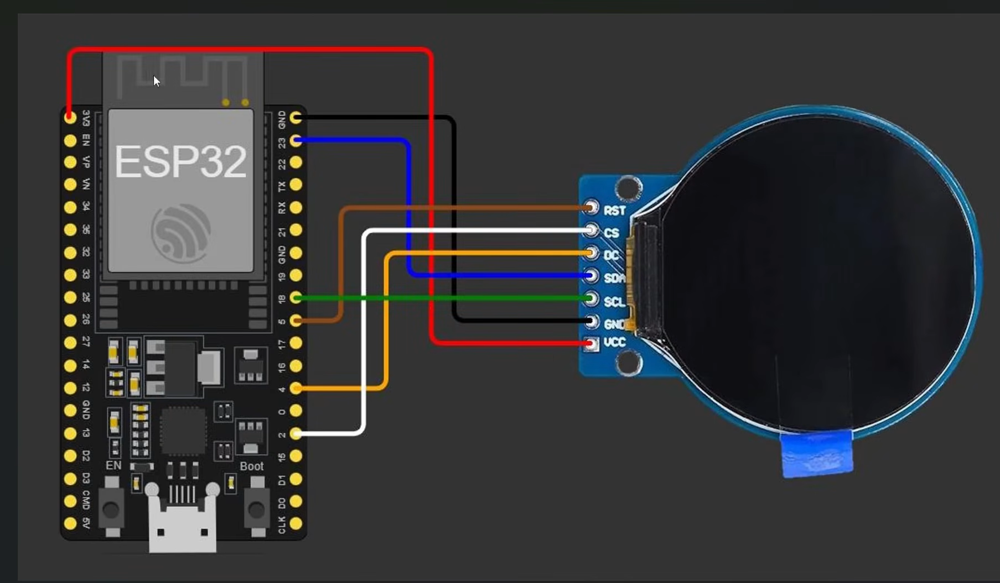

# GC9A01 IoT Light Display

Firmware ESP32 TFT 1.28: nhận downlink từ DTG IoT Hub và vẽ ảnh phòng lên màn GC9A01 1.28 inch.

## Datastream

| Hub downlink|
| `den_1'
| `den_2'
| `den_3'
| 'den_all'

## Pin

| Signal | LCD | GPIO |
|---|---|---|
| MOSI | SDA | 23 |
| SCLK | SCL | 18 |
| CS | CS | 2 |
| DC | DC | 4 |
| RST | RST | 5 |
| VCC | VCC | 3V3 |
| GND | GND | GND |
| BL | (module 7-pin: gắn sẵn VCC) | 22 |

SPI 20 MHz. Đổi pin trong `include/tft_setup.h`.



## Cấu trúc

```text
src/                 firmware
src/assets/          anh RGB565 240x240
include/             tft_setup.h, demo_images.h
lib/dtg/             DTG IoT client (Wi-Fi MQTT)
tools/               pack anh + SquareLine source
tests/               host test scene mapper
```

## Build

1. Copy `src/secrets.example.h` thành `src/secrets.h` và điền Wi-Fi + token DTG Hub.
2. Flash.

**Lưu ý quan trọng:** Khi dùng PlatformIO trên VS Code, chỉ cần chọn nút **Build** và **Upload** ở góc phải phía trên — không cần gõ lệnh CLI.

Hoặc dùng CLI:

```sh
pio run -t upload
pio device monitor
```

Partition `min_spiffs.csv` (app 1.9 MB). MQTT mặc định TLS `mqtt.dtgsoft.vn:8883`.

## Pack ảnh

```sh
python tools/pack_demo_images.py --only all
```
